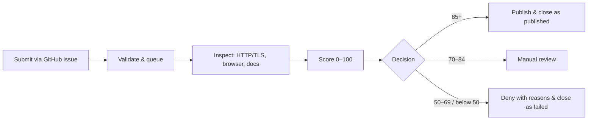

<div align="center">

# 🌐 Open Project Directory

[](https://unaveragetech.github.io/open-project-directory/)
[](https://github.com/unaveragetech/open-project-directory/actions/workflows/submission.yml)
[](https://github.com/unaveragetech/open-project-directory/actions/workflows/publishing.yml)
[](LICENSE)
[](https://unaveragetech.github.io/open-project-directory/)

### Find verified internet projects — every listing inspected, scored and checked before it goes live.

**[🔍 Browse the live directory](https://unaveragetech.github.io/open-project-directory/)** &nbsp;·&nbsp; **[➕ Submit a project](https://github.com/unaveragetech/open-project-directory/issues/new?template=submit-project.yml)** &nbsp;·&nbsp; **[⚡ Expedited review](https://unaveragetech.github.io/open-project-directory/expedited-review/)** &nbsp;·&nbsp; **[🤖 For Agents](https://unaveragetech.github.io/open-project-directory/agents/)**

</div>

---

A community-driven directory of internet services — automated discovery,
verification, and hosting — that pays for its own infrastructure through
advertising.

A developer submits a project via a GitHub issue. Automated workers inspect
the website (HTTP/TLS/DNS, headless-browser rendering, documentation),
score it, and, if it passes, generate a polished, searchable project profile
page and add it to the directory. Project owners get free exposure and a
hosted profile; visitors get a useful, independently accessible project page;
advertising revenue from legitimate impressions supports the service.

> **How a submission is handled is visible on the issue itself.** The
> pipeline comments on every submission: acceptance, inspection running,
> the full score breakdown, and then either a published link (closed,
> `published`) or the exact reasons it failed (closed, `failed`). See
> [How a submission flows](#how-a-submission-flows) below.

## ✨ Featured projects

| Project | What it is | Categories | Pricing | |
| --- | --- | --- | --- | --- |
| **[TokenBroker](https://unaveragetech.github.io/open-project-directory/project/tokenbroker/)** | Prepaid OpenAI-compatible AI API gateway — one key for hundreds of models; also speaks Anthropic `/v1/messages`, so Claude Code works with env vars only | AI, Developer Tools | Freemium | [🌐 Visit](https://tokenbroker.org) |
| **[Collectify](https://unaveragetech.github.io/open-project-directory/project/collectify/)** | Free, offline, no-account TCG collection app: camera OCR scanning, binders, price tracking, in-person trading, booster-pack mining game — 54 games, 440,000+ cards | Games, Utilities | Free | [🌐 Visit](https://unaveragetech.github.io/collectify-app) |
| **[Dead Grid](https://unaveragetech.github.io/open-project-directory/project/dead-grid/)** | Open-beta zombie survival game whose map is the player's real US neighbourhood (OpenStreetMap, 2020 Census horde size) | Games | Free | [🌐 Visit](https://unaveragetech.github.io/dead-grid) |
| *Example AI Assistant* | Clearly-marked example listing, not a real verified project | AI, Developer Tools | Free | [📄 Profile](https://unaveragetech.github.io/open-project-directory/project/example-ai-assistant/) |

## ➕ Submit a project

**[Submit a project via GitHub Issues →](https://github.com/unaveragetech/open-project-directory/issues/new?template=submit-project.yml)**

1. Fill in the form: project name, website URL, description, category, creator.
2. The pipeline validates it, comments acceptance, and queues it for inspection.
3. Inspection runs (HTTP/TLS, browser render, docs) and the score breakdown is posted on your issue.
4. **85+** → published, with the live profile link posted and the issue closed as `published`. **Below that** → a comment explaining exactly why, closed as `failed` (or `needs-review` for 70–84, left open for a human to check).

Already listed? A duplicate submission is closed as `published` with a link to the existing profile — no duplicate entry is ever added.

## 🔄 How a submission flows



1. **Issue Listener** — a new issue is validated against the template.
2. **Submission Normalizer** — fields parsed, URLs normalised, duplicates checked.
3. **Network Inspector** — DNS, HTTP, TLS, redirects, headers, robots/sitemap.
4. **Browser Inspector** — Playwright renders the real site: JS errors,
   broken images/links, empty/placeholder pages, mobile viewport, screenshot.
5. **Documentation Analyzer** — extracts docs/README/API metadata (LLM-assisted
   normalisation; every extracted feature must have a source URL — the LLM
   must not invent capabilities).
6. **Quality Evaluator** — scores 0–100 (see below); malware/phishing/
   deceptive-redirect findings override the score and block publication.
7. **Approval Controller** — auto-approve, manual review, request
   corrections, or reject.
8. **Page Builder** — Jinja2 generates the project profile.
9. **Publisher** — deploys the page, updates the database and directory index.
10. **GitHub Reporter** — comments inspection results + published URL on the issue.

The pipeline lives in [`src/pipeline/process_issue.py`](src/pipeline/process_issue.py)
and is driven by [`.github/workflows/submission.yml`](.github/workflows/submission.yml).
It reuses the existing parser, validator, normalizer, inspection, scoring
and generator code. The separate `inspection.yml` and `publishing.yml`
workflows still work unchanged.

## 📊 Quality scoring (0–100)

| Category | Weight |
| --- | --- |
| Website accessibility | 20 |
| Security and HTTPS | 15 |
| Content quality | 20 |
| Documentation | 15 |
| Functionality | 15 |
| Metadata completeness | 10 |
| Trust and consistency | 5 |
| **Total** | **100** |

Decisions: **85–100** automatic approval · **70–84** approval with warnings /
manual review · **50–69** request corrections · **below 50** reject or
quarantine. Malware, phishing, deceptive redirects, or dangerous downloads
prevent publication regardless of score. A passing score is a technical
quality signal, not an absolute guarantee that a service is trustworthy.

## 🔎 Finding projects

The directory index has a live search box matching name,
description, category and tags, a category filter, free / open-source
toggles, and tag chips for every tag in the catalog. Clicking a tag filters
to matching projects; clicking it again clears it; multiple tags combine
with AND. Project pages link each tag back to the index filtered by that
tag (`?tag=<tag>`). The index shows a result count and a "no projects
match" empty state when nothing matches. Each submitted site has its own
separate profile page at `project/<slug>/`.

## ⚡ Expedited review (proposed tiers)

Developers can speed up review by donating via Cash App, then emailing
the transaction code. **A donation only moves a submission up the
review queue — it does not guarantee approval.** Quality and safety
checks still apply, and a failed submission is not refunded
automatically (draft policy).

| Tier | Donation | General wait time |
| --- | --- | --- |
| Free | $0 | 10–14 days |
| Standard | $5 | 3–5 days |
| Priority | $15 | 24–48 hours |
| Same-day | $30 | Same day if submitted before 12pm ET, otherwise next day |

1. Submit via GitHub Issues and pick a tier in the form.
2. Donate via Cash App: https://cash.app/$slightlysigh
3. Email primecomputerpieces@gmail.com with your Cash App transaction
   code, the project name, and your GitHub issue number.

> **Proposed, not confirmed:** these amounts and wait times are
> suggestions for Jesse to confirm before going live. Full instructions
> in [docs/EXPEDITED_REVIEW.md](docs/EXPEDITED_REVIEW.md), tiers in
> [config/expedited_review.yml](config/expedited_review.yml), and the
> public page at `expedited-review/` on the directory site.

## 💰 Monetisation — compliance first

Advertising is a monetisation layer on top of the catalog, added without
changing the underlying architecture. The catalog and inspection engine
come first.

- Adsterra placements on project profile pages are clearly labelled
  **Sponsored** and open in a new tab.
- The optional discovery interstitial shows a clearly labelled ad, runs a
  short countdown, and then enables a **Continue to Project** button.
- **The Continue button works independently of whether any advertisement
  is clicked. Visitors are never required — or incentivised — to click an
  advertisement to unlock the destination.** The ad is never disguised
  as the Continue button.
- Forced/incentivised ad clicks can violate advertising-network policies,
  create invalid traffic, and jeopardise the entire revenue stream.
  See [docs/ADSTERRA_COMPLIANCE.md](docs/ADSTERRA_COMPLIANCE.md).
- **Written confirmation from Adsterra that this directory and
  interstitial inventory are eligible is still required before deploying
  this monetisation model at scale.** Do not scale on this design
  without it.

Adsterra smart link in use (zone `smart-link-3257926`, placement
`Smartlink_1`): `https://asiafilm.org/4/675577d5711a79f686def97bac8e688f`

## 🏗️ What this is — and what it is not

- **GitHub is the intake and automation interface**: Issues for submission,
  Actions for processing, the repository for templates and source code.
- **Production hosting is GitHub Pages**: https://unaveragetech.github.io/open-project-directory/
  — chosen by Jesse (2026-11-25) because it is easy, very light per project, and deploys
  as soon as the site is ready. The publishing workflow builds `site/` and deploys it
  with `actions/deploy-pages`; screenshots/assets live in the repo under `static/`.
- **Production database**: PostgreSQL is optional, for the catalog (project records,
  inspections, pages, traffic, advertising events) — it is not required for a Pages
  deploy. GitHub must never become the actual database; issue IDs are stored only as
  a permanent link between a submission and its project record.

One factual note: GitHub Pages is intended primarily for showcasing personal and
organisational projects, and its acceptable-use policy limits Pages content primarily
focused on advertising and promotional marketing, so mass ad-monetised Pages hosting
carries a policy risk. That is Jesse's explicit choice; a future move to Cloudflare
Pages or equivalent remains possible without changing the page templates, because
the generator output is plain static HTML.

## 🚀 Quick start

```bash
python3 -m venv .venv && .venv/bin/pip install -r requirements.txt
.venv/bin/pytest -q
.venv/bin/python -m src.publishing.generator --data data/projects.json --out site
# or: .venv/bin/python scripts/generate_site.py
```

Then serve the generated static site, e.g. `python3 -m http.server --directory site`.
Push to `main` and the publishing workflow deploys `site/` to GitHub Pages
(see [docs/DEPLOYMENT.md](docs/DEPLOYMENT.md)). Local preview with the Pages
subpath: `.venv/bin/python -m src.publishing.generator --base-path "" --out /tmp/opd-site`
then serve that directory, or serve the repo root so `/open-project-directory/` resolves.

## 🔁 Reverification

| Check | Frequency |
| --- | --- |
| HTTP availability | every 24 hours |
| TLS verification | every 24 hours |
| Full browser inspection | every 7 days |
| Documentation check | every 7 days |
| Metadata refresh | every 30 days |
| Full quality evaluation | every 30 days |

Failing sites are marked degraded, retried, then lose their operational
verification status and are suspended if still unavailable; the profile page
stays up with a visible warning where appropriate.

## 📈 Economics

Illustrative assumptions only — **not** Adsterra rate quotations or earnings
forecasts. Actual revenue depends on geography, inventory, advertiser
demand, viewability, invalid-traffic filtering, and other factors. Measure
actual revenue per thousand eligible impressions (RPM); do not assume a
fixed CPM.

| Monthly page views | Effective RPM (illustrative) | Monthly gross (illustrative) |
| --- | --- | --- |
| 10,000 | $1 | $10 |
| 50,000 | $2 | $100 |
| 100,000 | $3 | $300 |
| 500,000 | $3 | $1,500 |
| 1,000,000 | $4 | $4,000 |

The long-term asset is not the collection of landing pages; it is the
continuously maintained, machine-readable database of internet services
and projects.

## 🗂️ Repository layout

```
.github/ISSUE_TEMPLATE/   submit-project.yml, report-project.yml
.github/workflows/        submission.yml, inspection.yml, publishing.yml, maintenance.yml
src/submission/           parser.py, validator.py, normalizer.py
src/pipeline/             process_issue.py   (issue lifecycle: comments, labels, close)
src/inspection/           http_inspector.py, browser_inspector.py,
                          security_inspector.py, documentation.py, scoring.py
src/intelligence/         extractor.py, metadata.py, summarizer.py
src/publishing/           generator.py, templates.py, deployer.py
src/database/             models.py, repository.py, migrations/
src/advertising/          placements.py, analytics.py
src/api/                  routes.py, server.py   (FastAPI)
config/                   categories.yml, quality_rules.yml, settings.yml,
                          expedited_review.yml (proposed tiers)
docs/                     EXPEDITED_REVIEW.md, ARCHITECTURE.md, DEPLOYMENT.md,
                          ADSTERRA_COMPLIANCE.md
templates/                project.html, directory.html, interstitial.html,
                          expedited.html
data/projects.json        seed catalog (verified projects only)
tests/                    pytest suite
```

## 🔒 Security

Submissions are untrusted input. The worker runs with minimum GitHub token
permissions, never executes submitted scripts or repository workflows,
treats issue content as data only, blocks localhost / private IP ranges /
cloud metadata addresses (`169.254.169.254`) and unsafe redirects, revalidates
DNS after redirects (SSRF guard), and limits response sizes, execution time,
and crawl depth. All generated HTML is sanitised; external sites cannot
inject scripts into generated pages. See `src/inspection/security_inspector.py`.

## ✉️ Contact

- **General questions, corrections, or to report a listing:**
  [primecomputerpieces@gmail.com](mailto:primecomputerpieces@gmail.com)
- **Expedited review transaction codes:**
  [primecomputerpieces@gmail.com](mailto:primecomputerpieces@gmail.com)
  (Cash App: https://cash.app/$slightlysigh — see
  [Expedited review](#expedited-review-proposed-tiers) above)
- **Submit a project:**
  [GitHub Issues — Submit a Project](https://github.com/unaveragetech/open-project-directory/issues/new?template=submit-project.yml)

## License

MIT — see [LICENSE](LICENSE).
